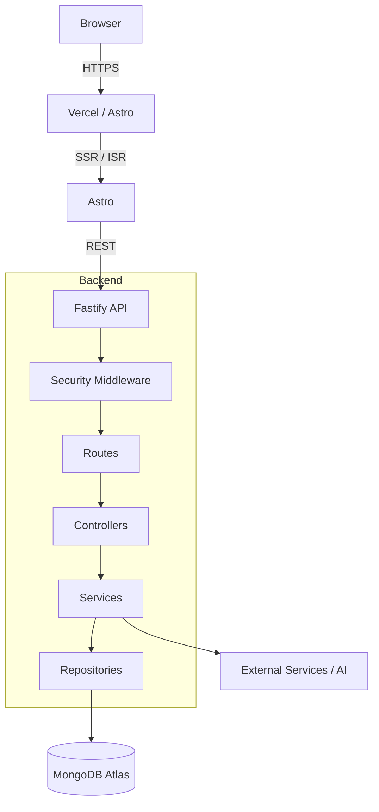

# CodeForge

[](https://github.com/AeSoul0/CodeForge)
[](https://fastify.dev/)
[](https://astro.build/)
[](https://nodejs.org/)
[](https://www.typescriptlang.org/)
[](https://www.docker.com/)

A production-oriented full-stack portfolio and administrative platform built
to demonstrate modern software engineering practices across architecture,
security, testing, accessibility and performance.

**Live:** https://www.aesoul0.com

---

## Engineering Snapshot

CodeForge is evaluated using measurable engineering evidence rather than feature
count alone. Every push runs the same quality gates in CI:

* lint and type checks (backend `tsc`, frontend `astro check`);
* backend unit/API tests with coverage thresholds (85/80/85/85);
* frontend unit and component-rendering tests with coverage thresholds (90/90/90/90);
* production builds;
* Playwright E2E, including axe accessibility scans of public and admin pages;
* dependency audits and CodeQL.

**Current numbers live in one place: [docs/metrics.md](docs/metrics.md).**
That file is generated from test output by `npm run metrics` and republished
in the CI job summary, so no other document repeats them.

---

# Architecture




## Frontend

* Astro
* Tailwind CSS
* TypeScript
* Vercel SSR
* Vercel ISR

Astro renders every page. Client-side behaviour (admin dashboard, particle
background, project filter) lives in small TypeScript modules in
`frontend/src/lib` and `frontend/src/scripts`, bundled by Astro. No UI
framework runtime is shipped to the browser.

The current ISR configuration uses a:

```text
300 second expiration
```

## Backend

* Node.js 24.x
* Fastify
* TypeScript
* Mongoose
* MongoDB Atlas

The backend follows:

```text
Routes
  ↓
Controllers
  ↓
Services
  ↓
Repositories
  ↓
MongoDB
```

This keeps transport, business and persistence responsibilities separated.

---

# Key Engineering Decisions

Important architectural decisions are documented as ADRs:

* [ADR 001 — Astro](docs/adr/001-astro.md)
* [ADR 002 — Fastify](docs/adr/002-fastify.md)
* [ADR 003 — JWT Cookie Authentication](docs/adr/003-jwt-cookie-auth.md)
* [ADR 004 — AI Service Boundary](docs/adr/004-ai-enrichment.md)
* [ADR 005 — MongoDB](docs/adr/005-mongodb.md)
* [ADR 006 — Vercel ISR Performance](docs/adr/006-vercel-isr-performance.md)

Additional architecture documentation:

* [Architecture](docs/architecture.md)
* [Deployment](docs/deployment.md)

---

# Technology Stack

## Frontend

```text
Astro
Tailwind CSS
TypeScript
Vercel
```

## Backend

```text
Node.js 24.x
Fastify
TypeScript
Mongoose
```

## Database

```text
MongoDB Atlas
```

## Testing

```text
Vitest
Supertest
happy-dom
Astro Container API
V8 Coverage
Playwright
axe-core
```

## Security

```text
Helmet
Hash-based CSP (no 'unsafe-inline')
CSRF guard (origin + custom header)
HSTS
CORS
JWT
HttpOnly / Secure / SameSite cookies
Rate limiting
bcrypt
Audit logging
```

---

# Testing

CodeForge uses a layered testing strategy:

```text
Static validation
      ↓
Unit tests
      ↓
API / integration tests
      ↓
Security tests
      ↓
Production build
      ↓
Browser E2E
```

## Backend

Vitest unit, API and security tests run against a real MongoDB instance.
Coverage thresholds: statements 85%, branches 80%, functions 85%, lines 85%.

## Frontend

Vitest runs in two modes:

* client modules (admin dashboard, API client, particle animation, page
  effects) against happy-dom;
* `.astro` pages and components rendered with the Astro Container API, so
  server-side templates count toward coverage.

The admin tests mount the real page markup before running the client code,
which keeps element ids and scripts in sync. Coverage thresholds are 90% for
statements, branches, functions and lines.

## E2E

Playwright exercises the real backend and frontend:

* homepage, project pages and API failure handling;
* login, logout and protected-route redirects for every admin page;
* admin CRUD for projects and experiences (including logo upload);
* API playground, system status and mobile navigation;
* axe accessibility scans and keyboard navigation.

Results: [docs/metrics.md](docs/metrics.md).

More details:

[Testing documentation](docs/testing.md)

---

# Security

CodeForge uses defense-in-depth security controls.

## Authentication

JWT authentication is configured with:

* explicit algorithm policy;
* issuer;
* audience;
* expiration;
* HttpOnly cookies;
* Secure cookies in production;
* SameSite protection.

## Authorization

Authentication and authorization are separate concerns.

Protected operations require the appropriate authenticated and authorized
context.

## HTTP Security

Implemented controls include:

* Content-Security-Policy without `'unsafe-inline'`;
* HSTS;
* clickjacking protection;
* Referrer Policy;
* restricted CORS.

## Abuse Protection

Rate limiting is applied to protect sensitive endpoints.

Security tests verify brute-force behavior including:

```text
429 Too Many Requests
```

## CSRF Protection

The session cookie is `SameSite=None` in production (frontend and API are
different sites), so state-changing requests that carry it must also:

* come from an allowed origin (Origin/Referer check);
* send the `X-Requested-With: CodeForge` header, which cross-site pages
  cannot add without passing the CORS allowlist.

Login requests are origin-checked as well.

## Content Security Policy

* Frontend: Astro hashes every emitted script and style
  (`security.csp`), so `script-src` and `style-src` contain no
  `'unsafe-inline'`.
* API: JSON responses use `default-src 'none'`; Swagger UI (development
  only) sends its own hash-based policy.

## Dependency Security

`npm audit --audit-level=high` runs for both packages in CI, alongside
Dependabot and CodeQL.

Full security documentation:

[Security Architecture](docs/security.md)

---

# Accessibility

Accessibility is treated as an engineering requirement rather than a visual
afterthought.

Implemented support includes:

* semantic HTML;
* accessible landmarks;
* skip navigation;
* explicit form labels;
* accessible names;
* visible keyboard focus;
* keyboard navigation;
* reduced-motion handling;
* appropriate ARIA usage.

## Measured Result

Lighthouse and axe results are tracked in [docs/metrics.md](docs/metrics.md).
The Playwright suite fails on any axe violation in the audited pages.

See:

[Accessibility](docs/accessibility.md)

---

# Performance

The production homepage is optimized around:

* Astro rendering;
* Vercel ISR;
* limited client-side JavaScript;
* efficient decorative rendering;
* reduced-motion support;
* visibility-aware animation.

## Latest Lighthouse Measurement

The latest recorded Lighthouse scores are in
[docs/metrics.md](docs/metrics.md) (source: `docs/metrics-lighthouse.json`).
Lighthouse is run manually against production; re-run it after
frontend changes that affect loading.

Full performance documentation:

[Performance Baseline](docs/performance.md)

---

# CI/CD

CodeForge is designed around automated quality gates.

The pipeline (`.github/workflows/ci.yml`) runs on pushes to `main` and on
pull requests targeting `main`:

```text
Validate (lint, tsc, astro check)
   ↓
Backend Tests + Coverage
   ↓
Frontend Tests + Coverage
   ↓
Build
   ↓
E2E
   ↓
Security
   ↓
Quality Gate
```

Each run regenerates [docs/metrics.md](docs/metrics.md) from the test
output and publishes it in the GitHub Actions job summary.

---

# Admin Dashboard

`/admin` is a session-protected area (HttpOnly JWT cookie, verified against
`GET /api/auth/me` on every page):

| Page | Purpose |
|---|---|
| Overview | Project/experience counts, projects awaiting AI documentation, backend status, recently updated projects |
| Projects | Search, create, edit and delete projects; categories, linked experience, image and GitHub link; trigger AI documentation regeneration |
| Experiences | Create, edit and delete experiences with month pickers, "current role" handling and logo upload |
| API Playground | Send authenticated requests from presets, inspect status/timing/body, local request history |
| System | Liveness/readiness probes, request and error-rate metrics, optional 30 s auto-refresh |

All API data is written to the DOM with `textContent`/attributes (never
`innerHTML`), dialogs use the native `<dialog>` element, and destructive
actions go through a confirmation dialog. The client logic lives in
`frontend/src/lib/admin/` and is unit-tested against the real page markup.

---

# API

CodeForge exposes a Fastify REST API for:

* authentication;
* projects;
* experiences;
* administration;
* health checks.

The API follows:

```text
Request
  ↓
Validation
  ↓
Controller
  ↓
Service
  ↓
Repository
  ↓
MongoDB
```

Swagger/OpenAPI support is included for API exploration and contract
documentation.

See:

[API Documentation](docs/api.md)

---

# Environment Setup

## Requirements

The repository uses Node.js 24.x for the backend runtime.

Install dependencies:

```bash
cd backend
npm ci

cd ../frontend
npm ci
```

Configure the required environment variables for the selected environment.

Important configuration categories include:

```text
MONGODB_URI
JWT_SECRET
ADMIN_API_KEY          # also the seeded admin password
FRONTEND_URL           # CORS + CSRF allowed origin
PUBLIC_API_URL         # frontend, build time: API URL and CSP connect-src
RATE_LIMIT_MAX         # optional, default 100 req/min per client
LOGIN_RATE_LIMIT_MAX   # optional, default 5 logins/min per client
```

See [Deployment](docs/deployment.md#7-environment-variables) for details.

Never commit real production credentials.

---

# Local Development

## Backend

```bash
cd backend
npm run dev
```

## Frontend

```bash
cd frontend
npm run dev
```

The frontend and backend use separate development servers and communicate
through the configured API URL.

---

# Verification Commands

## Backend

```bash
cd backend

npm run lint
npm run typecheck
npm run test:cov
npm audit --audit-level=high
```

## Frontend

```bash
cd frontend

npm run lint
npm run typecheck
npm run test:cov
npm run build
npm run test:e2e
npm audit --audit-level=high
```

## Metrics

```bash
# after backend/frontend `npm run test:ci` and `npm run test:e2e`
npm run metrics   # rewrites docs/metrics.md
```

## Lighthouse

```bash
npx lighthouse https://www.aesoul0.com \
  --output json \
  --output-path ./lighthouse-home.json \
  --chrome-flags="--headless"
```

---

# Deployment

Production architecture:

```text
Vercel
  ↓
Astro SSR / ISR
  ↓
Render
  ↓
Fastify
  ↓
MongoDB Atlas
```

The frontend uses Vercel.

The backend uses Render.

The database uses MongoDB Atlas.

See:

[Deployment Strategy](docs/deployment.md)

---

# Observability

The backend uses structured request logging and audit logging.

Request-level diagnostics include identifiers and response timing.

Critical application operations are recorded through the audit logger.

Examples include:

```text
CREATE_PROJECT
UPDATE_EXPERIENCE
DELETE_PROJECT
```

Rejected CSRF and authentication attempts are logged as warnings.

The observability layer is intentionally lightweight and designed to provide
useful diagnostics without introducing unnecessary infrastructure complexity.

---

# Project Structure

```text
CodeForge/
├── backend/
│   ├── src/
│   │   ├── controllers/  routes/  services/  repositories/  models/
│   │   ├── middlewares/        auth, CSRF guard, metrics
│   │   └── utils/
│   └── tests/                  unit/ and api/ (Vitest)
│
├── frontend/
│   ├── src/
│   │   ├── pages/              public pages, /admin, /api/health
│   │   ├── components/  layouts/
│   │   ├── lib/                API client, DOM/format/Markdown helpers
│   │   │   └── admin/          admin dashboard modules
│   │   └── scripts/            public-page client modules
│   ├── tests/                  unit/, admin/, render/ (Vitest)
│   ├── e2e/                    Playwright
│   └── scripts/serve-build.mjs serve the production build locally
│
├── docs/
│   ├── adr/                    ADR 001–006
│   ├── metrics.md              generated: tests, coverage, Lighthouse
│   ├── metrics-lighthouse.json manual Lighthouse record
│   ├── accessibility.md  api.md  architecture.md  deployment.md
│   ├── developer-experience.md  engineering-scorecard.md  evidence.md
│   ├── performance.md  roadmap.md  security.md  testing.md
│   └── case-studies/
│
├── scripts/
│   ├── collect-metrics.mjs     builds docs/metrics.md
│   ├── projects/  experiences/ content CLI scripts
│
└── .github/
    └── workflows/              ci.yml, security.yml
```

---

# Engineering Evidence

The repository maintains dedicated evidence documentation:

* [Quality Metrics](docs/metrics.md) (single source of numbers)
* [Engineering Scorecard](docs/engineering-scorecard.md)
* [Engineering Evidence](docs/evidence.md)
* [Architecture](docs/architecture.md)
* [Security](docs/security.md)
* [Testing](docs/testing.md)
* [Performance](docs/performance.md)
* [Deployment](docs/deployment.md)
* [API](docs/api.md)
* [Professional Roadmap](docs/roadmap.md)

The evidence model separates:

```text
Implemented
Verified
Measured
Pending
```

This ensures the README does not present assumptions or targets as actual
measurements.

---

# Current Engineering Position

CodeForge currently demonstrates strong evidence across:

```text
Architecture
Backend Engineering
Frontend Engineering
Security
Testing
Coverage
Accessibility
Performance
SEO
Dependency Health
Documentation
```

Measured results: [docs/metrics.md](docs/metrics.md).

---

# Remaining Engineering Work

The core application engineering work for the 90/100 roadmap is substantially
complete.

Known open items:

1. Re-run Lighthouse on production after the 2026-10 frontend changes
   (scripts moved to modules, duplicate particle canvas removed) and update
   `docs/metrics-lighthouse.json`.
2. Record a production INP measurement (requires real-user field data).
3. The content CLI scripts in `scripts/projects` and `scripts/experiences`
   send an `x-api-key` header the backend does not check, so their writes
   are rejected; they need to log in (cookie + `X-Requested-With`) instead.
4. Two moderate advisories remain in `@tailwindcss/typography` (build-time
   only; the fix requires a breaking downgrade). No high/critical advisories.
5. JWTs cannot be revoked before their 24 h expiry.

---

# Engineering Philosophy

CodeForge prioritizes:

> **measured engineering over speculative complexity.**

The project favors:

* clear boundaries;
* explicit contracts;
* security by default;
* testable business logic;
* measured performance;
* accessible interfaces;
* reproducible validation;
* documented architectural decisions.

The goal is not to maximize the number of technologies or features.

The goal is to demonstrate that the system can be understood, tested,
measured, secured and maintained like a professional engineering project.

---

# License

© 2026 ÆSoul. All rights reserved.

This project and its source code are proprietary and belong exclusively to
ÆSoul.

Unauthorized copying, modification, distribution or commercial use is
prohibited.

```
```
