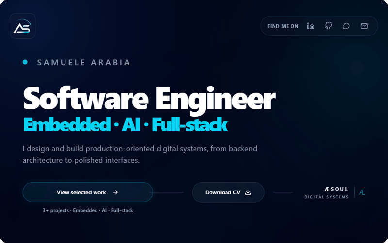
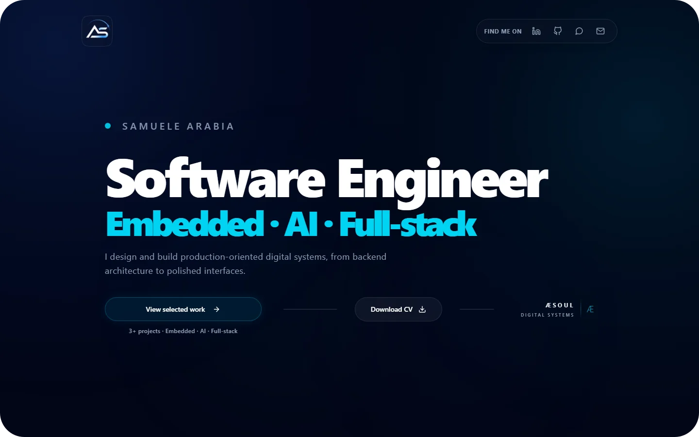
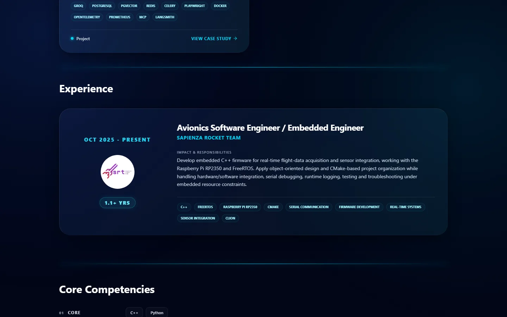
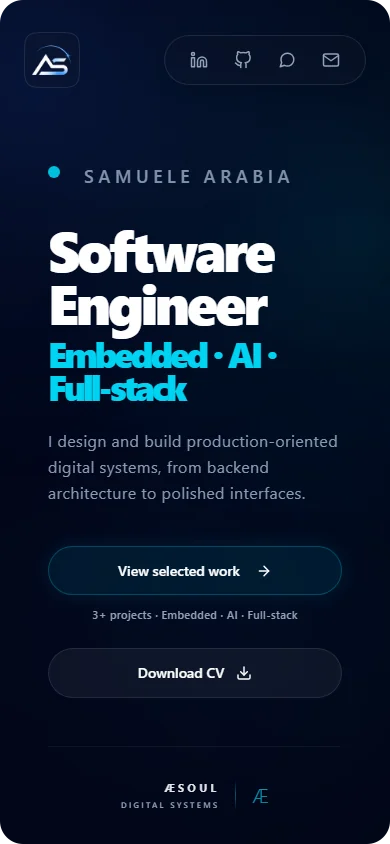
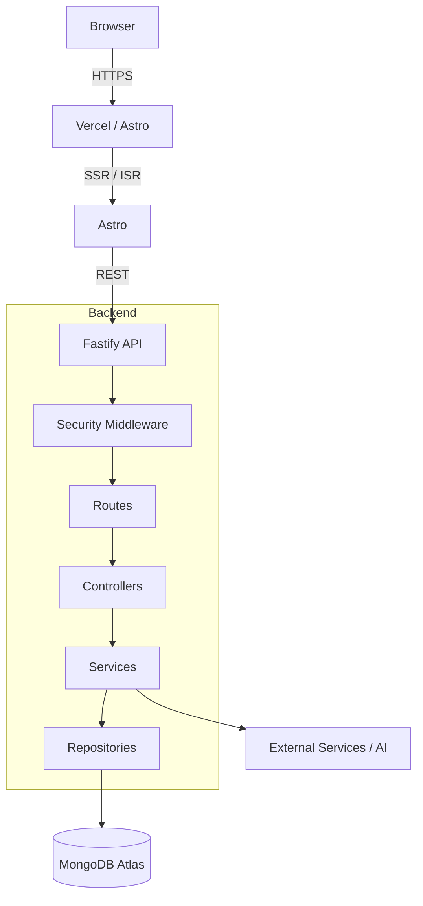

# CodeForge

[](https://github.com/AeSoul0/CodeForge)
[](https://fastify.dev/)
[](https://astro.build/)
[](https://nodejs.org/)
[](https://www.typescriptlang.org/)

A production-oriented full-stack portfolio and administrative platform built
to demonstrate modern software engineering practices across architecture,
security, testing, accessibility and performance.

**Live:** https://aesoul0.com



| Homepage | Experience timeline | Mobile |
|---|---|---|
| [](docs/screenshots/home-desktop.webp) | [](docs/screenshots/experience-desktop.webp) | [](docs/screenshots/home-mobile.webp) |

## Quick Start

Requires Node.js 24 (`.nvmrc`) and a local MongoDB on `localhost:27017`.

```bash
cd backend && npm ci && cp .env.example .env    # fill in JWT_SECRET, ADMIN_API_KEY, ...
npm run dev                                      # API on the port in PORT

# in a second terminal
cd frontend && npm ci
PUBLIC_API_URL=http://localhost:<PORT> npm run dev   # site on http://localhost:2003
```

Full setup: [Environment Setup](docs/project-guide.md#environment-setup). Checks to run before a
PR: [Verification Commands](docs/project-guide.md#verification-commands).

---

## Engineering Snapshot

CodeForge is evaluated using measurable engineering evidence rather than feature
count alone. Every push runs the same quality gates in CI:

* lint and type checks (backend `tsc`, frontend `astro check`);
* backend unit/API tests with coverage thresholds (85/80/85/85);
* frontend unit and component-rendering tests with coverage thresholds (90/90/90/90);
* production builds;
* Playwright E2E, including axe accessibility scans of public and admin pages;
* dependency audits and CodeQL.

**Current numbers live in one place: [docs/metrics.md](docs/metrics.md).**
That file is generated from test output by `npm run metrics` and republished
in the CI job summary; other documents link to it instead of repeating the
current numbers (dated historical measurements excepted).

---

# Architecture




## Frontend

* Astro
* Tailwind CSS
* TypeScript
* Vercel SSR
* Vercel ISR

Astro renders every page. Client-side behaviour (admin dashboard, particle
background, project filter) lives in small TypeScript modules in
`frontend/src/lib` and `frontend/src/scripts`, bundled by Astro. No UI
framework runtime is shipped to the browser.

The current ISR configuration uses a:

```text
300 second expiration
```

## Backend

* Node.js 24.x
* Fastify
* TypeScript
* Mongoose
* MongoDB Atlas

The backend follows:

```text
Routes
  ↓
Controllers
  ↓
Services
  ↓
Repositories
  ↓
MongoDB
```

This keeps transport, business and persistence responsibilities separated.

---

# Key Engineering Decisions

Important architectural decisions are documented as ADRs:

* [ADR 001 — Astro](docs/adr/001-astro.md)
* [ADR 002 — Fastify](docs/adr/002-fastify.md)
* [ADR 003 — JWT Cookie Authentication](docs/adr/003-jwt-cookie-auth.md)
* [ADR 004 — AI Service Boundary](docs/adr/004-ai-enrichment.md)
* [ADR 005 — MongoDB](docs/adr/005-mongodb.md)
* [ADR 006 — Vercel ISR Performance](docs/adr/006-vercel-isr-performance.md)

Additional architecture documentation:

* [Architecture](docs/architecture.md)
* [Deployment](docs/deployment.md)

---

# Documentation

* [Project Guide](docs/project-guide.md): stack, testing, security,
  accessibility, performance, CI/CD, admin dashboard, API, setup, deployment,
  operations and project structure
* [Quality Metrics](docs/metrics.md) (single source of numbers)
* [Engineering Scorecard](docs/engineering-scorecard.md)
* [Engineering Evidence](docs/evidence.md)
* [Architecture](docs/architecture.md)
* [Security](docs/security.md)
* [Testing](docs/testing.md)
* [Performance](docs/performance.md)
* [Deployment](docs/deployment.md)
* [Operations](docs/operations.md)
* [API](docs/api.md)
* [Professional Roadmap](docs/roadmap.md)

Documents separate what is implemented, verified, measured and still pending,
so targets are never presented as measurements.

---

# Remaining Engineering Work

The 90/100 roadmap is complete: every engineering item is implemented,
tested and measured. No new technology is planned just to add features; what
remains is verification, tracked in
[operations.md § 6](docs/operations.md#6-open-verification-items):

1. **Field performance:** a production INP measurement needs real-user data;
   lab interaction latency is 64–112 ms
   ([performance.md](docs/performance.md#inp)).
2. **Independent security review:** not done yet; CodeQL, `npm audit`,
   Dependabot and the API security tests run in CI.

Accepted limitations:

* JWTs cannot be revoked one by one before their 24 h expiry; all sessions
  can be ended by rotating `JWT_SECRET`
  ([operations.md § 5](docs/operations.md#5-session-revocation)).
* Two moderate advisories remain in `@tailwindcss/typography` (build-time
  only; the fix requires a breaking downgrade). No high/critical advisories.
* TypeScript 7 is on hold until `@astrojs/check` and `typescript-eslint`
  accept it as a peer dependency.

---

# License

© 2026 ÆSoul. All rights reserved.

The repository is public so that the code, tests and documentation can be
read and evaluated. That is the only permission given: no open-source
licence applies, and the code may not be copied, modified, redistributed or
used commercially without written permission from ÆSoul.
